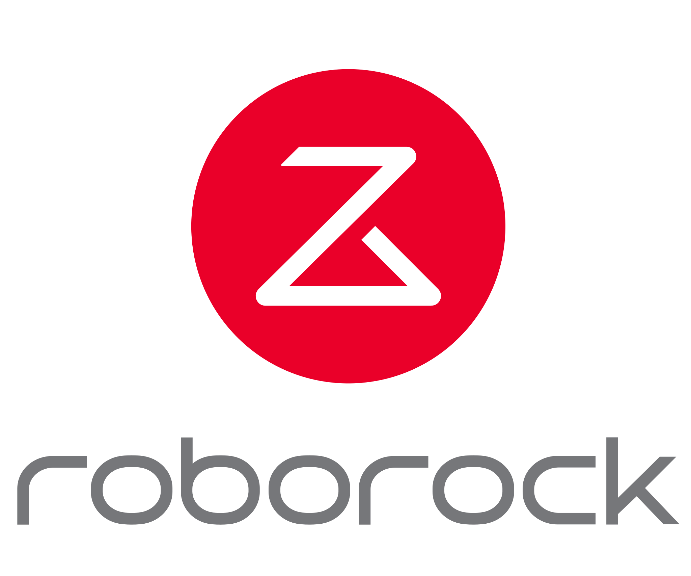
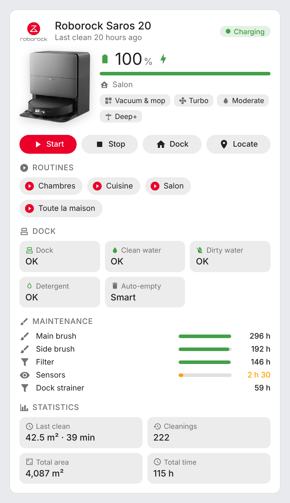
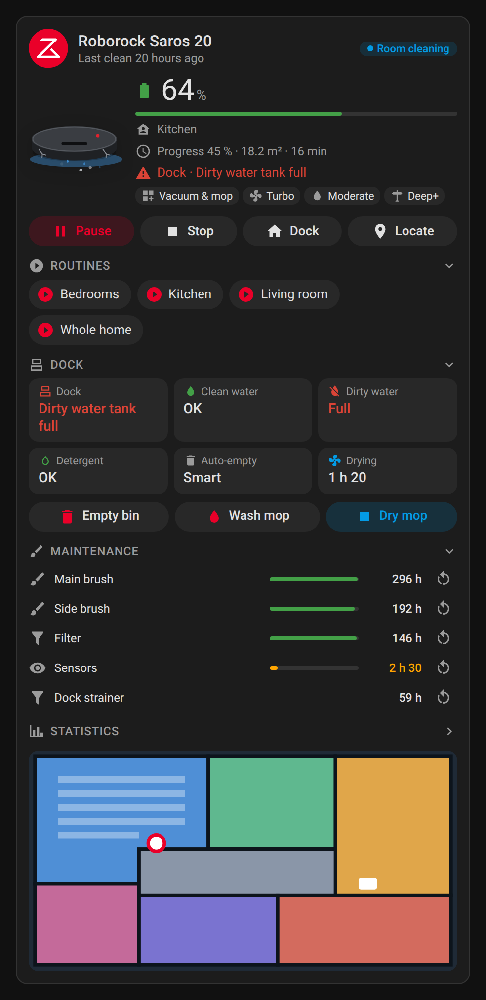
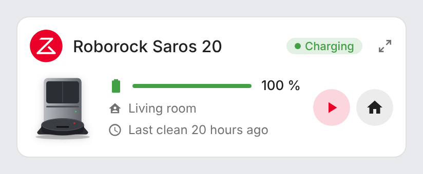
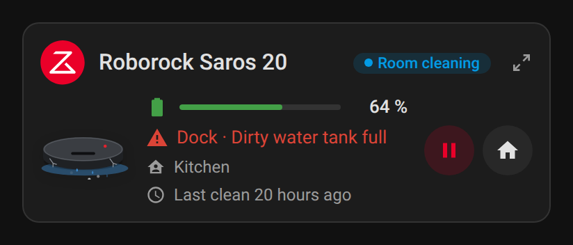
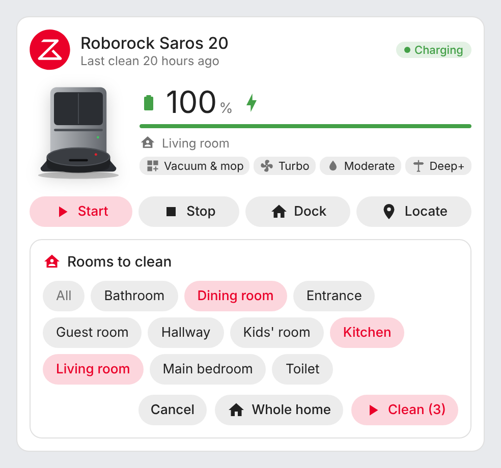
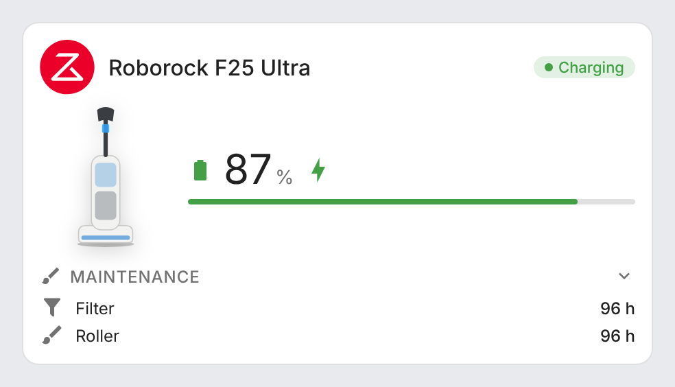
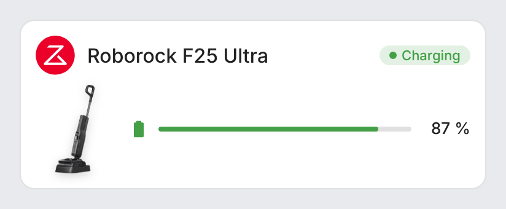

# ha-roborock-card

[](https://github.com/hacs/integration)
[](https://github.com/juju35/ha-roborock-card/actions/workflows/validate.yml)
[](https://github.com/juju35/ha-roborock-card/actions/workflows/build.yml)
[](https://github.com/juju35/ha-roborock-card/releases/latest)
[](LICENSE)

<p align="center"></p>

Lovelace cards for Home Assistant to monitor and control [Roborock](https://www.roborock.com) robot vacuums and wet-dry vacuums: status, battery, room, routines, dock, maintenance and statistics at a glance.

The cards are built on top of the [Roborock integration](https://www.home-assistant.io/integrations/roborock/) included in Home Assistant: entities are **discovered automatically** from the Home Assistant registries, you don't have to pick them one by one, and it works whatever your Home Assistant language.

[](https://my.home-assistant.io/redirect/hacs_repository/?owner=juju35&repository=ha-roborock-card&category=plugin)

| Roborock Card | Roborock Mini Card |
|---|---|
|  |  |

## Features

- Two cards: a full **Roborock Card** and a compact **Roborock Mini Card**
- Robot vacuums and wet-dry vacuums, with a device picture chosen per model (Saros 20, F25 Ultra) or your own
- Automatic discovery of the Roborock devices (several devices supported, dock merged with its robot)
- Battery, status, current room, cleaning progress and errors
- Cleaning settings: mode, suction power, mop intensity and route
- Start / pause, stop, return to dock and locate buttons
- Room selector: the Start button lets you pick the rooms to clean (or the whole home)
- Routines from the Roborock app as one-tap buttons (with confirmation)
- Dock: clean and dirty water tanks, detergent, auto-empty mode, mop drying, and Empty bin / Wash mop / Dry mop buttons
- Maintenance: main brush, side brush, filter, sensors, dock strainer… with remaining time and a reset button (with confirmation) when the integration provides one
- Statistics: last clean, number of cleanings, total area and time
- Map of the current floor while the robot is cleaning (or always, or never), with optional cropping, enlarged full screen on click
- Click any value to open its Home Assistant history (more-info dialog)
- Click the Roborock logo to open [roborock.com](https://www.roborock.com)
- Visual editor in the dashboard UI for both cards (no YAML needed)
- Light and dark mode, English and French
- Single file, no external dependency, the logo and pictures are embedded

## Prerequisites

The [Roborock integration](https://www.home-assistant.io/integrations/roborock/) must be configured, with Home Assistant 2024.1 or later.

## Installation

### Via HACS (recommended)

Click the button below to add the repository directly:

[](https://my.home-assistant.io/redirect/hacs_repository/?owner=juju35&repository=ha-roborock-card&category=plugin)

Then click **Download**, and reload your browser when HACS asks you to.

Or manually:

1. Open HACS → **⋮** (top right) → **Custom repositories**
2. Add `https://github.com/juju35/ha-roborock-card` — Type: **Dashboard**
3. Search for **Roborock Card** and click **Download**
4. Clear your browser cache and refresh

### Manual

1. Download `roborock-card.js` from the [latest release](https://github.com/juju35/ha-roborock-card/releases/latest) (or `dist/roborock-card.js` from this repository)
2. Copy it to `/config/www/roborock-card.js`
3. Go to **Settings → Dashboards → ⋮ → Resources** → Add resource:
   - URL: `/local/roborock-card.js`
   - Type: **JavaScript Module**
4. Clear your browser cache and refresh

## Configuration

### Visual editor

Edit a dashboard, click **Add card** and search for **Roborock Card** or **Roborock Mini Card**. The first robot vacuum is preselected; pick another device in the list if you have several, set an optional title, choose the picture, the sections to display and the language. The preview updates live, and options left at their default are kept out of the generated YAML.

### Minimal

```yaml
type: custom:roborock-card
```

```yaml
type: custom:roborock-mini-card
```

### Full options

```yaml
type: custom:roborock-card
device: Roborock Saros 20
title: Saros
image: auto
show_logo: true
show_controls: true
room_selection: true
show_modes: true
show_routines: true
show_dock: true
show_consumables: true
show_stats: true
show_map: cleaning
crop:
  top: 170
  bottom: 190
  left: 180
  right: 150
language: fr
```

```yaml
type: custom:roborock-mini-card
device: Roborock F25 Ultra
title: F25
image: auto
show_logo: true
show_controls: true
room_selection: true
language: fr
```

### Options reference

| Option | Card | Default | Description |
|---|---|---|---|
| `device` | both | First robot vacuum | Roborock device to display: its name (as shown in Home Assistant) or its device id (set by the visual editor) |
| `title` | both | Device name | Card title |
| `image` | both | `auto` | Device picture: `auto` (per model), `saros_20`, `f25_ultra`, `none`, or the URL of your own picture (e.g. `/local/my-robot.png`) |
| `show_logo` | both | `true` | Show the Roborock logo (opens [roborock.com](https://www.roborock.com) in a new tab) |
| `show_controls` | both | `true` | Start / pause, stop, dock and locate buttons (robot vacuums), dock actions (empty bin, wash and dry mop) and maintenance reset buttons |
| `room_selection` | both | `true` | The Start button opens the room selector; `false` starts a full cleaning right away |
| `show_modes` | full | `true` | Cleaning mode, suction power, mop intensity and route |
| `show_routines` | full | `true` | Routines buttons |
| `show_dock` | full | `true` | Dock status |
| `show_consumables` | full | `true` | Maintenance (remaining time of brushes, filter, sensors…) |
| `show_stats` | full | `true` | Cleaning statistics |
| `show_map` | full | `cleaning` | Map of the current floor: `cleaning` (only while the robot is cleaning), `always` (or `true`) or `never` (or `false`) |
| `crop` | full | — | Crop the map, in pixels of the map image: `top`, `bottom`, `left` and/or `right` (see below) |
| `language` | both | Auto | Force language: `fr` or `en` (auto-detects from HA settings) |

### Cropping the map

The map image of the integration usually has wide empty borders. Remove them with `crop`, in pixels of the original image (all four values are optional):

```yaml
type: custom:roborock-card
crop:
  top: 170
  bottom: 190
  left: 180
  right: 150
```

In the visual editor, the values are under **Map crop (pixels)**.

Click the map to open it full screen; click anywhere or press Escape to close it.

## Screenshots

| Light | Dark (French, cleaning: the map is shown) |
|---|---|
|  |  |
|  |  |

Room selector (opened by the Start button):



Wet-dry vacuum (F25 Ultra):

| Roborock Card | Roborock Mini Card |
|---|---|
|  |  |

## How it works

The cards read the Home Assistant entity and device registries instead of entity ids: every entity of the Roborock integration is matched by its `translation_key` (`status`, `current_room`, `main_brush_time_left`, `dirty_box_full`…) and by the device it belongs to. The dock entities, which the integration puts on a separate "… Dock" device, are attached to their robot. Entity ids can therefore be in any language or renamed without breaking the cards.

States and errors are shown with the card's own translations when available, otherwise with Home Assistant's translation of the integration.

The device picture is chosen from the model: robot vacuums show the Saros 20, wet-dry vacuums (`roborock.wdv.*`) show the F25 Ultra. Use the `image` option to pick another one or your own.

The room selector reads the rooms of the current map (the one chosen in the integration's **Selected map** select) with the `roborock.get_maps` service, then cleans the selected rooms with the same `app_segment_clean` command the integration uses. When the robot is paused, the Start button resumes the cleaning instead.

Routines created in the Roborock app appear as buttons in the integration; the card lists them and asks for confirmation before running one.

Each maintenance line has a reset button when the integration exposes the matching **Reset … consumable** button (main brush, side brush, filter, sensors, dock strainer, dock brush). It asks for confirmation before resetting the counter.

Maintenance thresholds: the remaining time turns orange under 10 % of the part lifetime (or under 10 h when the lifetime is unknown), and red when it reaches 0. Bars use the Roborock lifetimes: main brush 300 h, side brush 200 h, filter 150 h, sensors 30 h.

## Development

```bash
npm install
npm run build        # bundles src/roborock-card.js + images/ into dist/roborock-card.js
npm run check        # verifies dist/ is up to date (run in CI)
npm run screenshots  # renders the cards with mock data (scripts/mock-states.mjs) into screenshots/
```

### Releasing

1. Add a `## <version>` section at the top of [CHANGELOG.md](CHANGELOG.md)
2. Run the **Release** workflow from the Actions tab with that version

The workflow builds the card, creates the tag and the GitHub release with the changelog section as notes, and attaches `roborock-card.js`.

## Translations

The cards auto-detect the language from your Home Assistant settings. Currently supported:

| Language | Code |
|---|---|
| English | `en` |
| Français | `fr` |

Contributions for additional languages are welcome!

## Credits

Roborock, the Roborock logo and the product pictures are trademarks and property of Roborock. This project is not affiliated with Roborock.

## License

[MIT](LICENSE)
